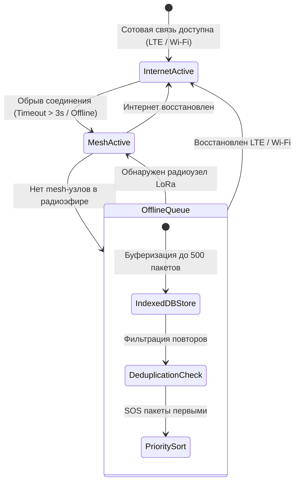

# Коммуникационный слой и гибридный транспорт (Communication & Transport Architecture)

**Статус документа:** `PRODUCTION_READY`  
**Категория:** Архитектурная спецификация (`03-architecture`)  
**Версия:** 0.6.0  
**Авторы:** Даниил, Александр, Кирилл

---

## 1. Концепция Transport Abstraction

Коммуникационный слой Treeline Tracker изолирует приложение от конкретных физических каналов передачи данных. Логика отправки координат, текстовых сообщений и экстренных сигналов бедствия не зависит от того, передаются ли данные через сотовую сеть (HTTPS REST / WSS), радиоканал LoRa Meshtastic (WebSerial / WebBluetooth BLE / MQTT) или сохраняются в персистентную очередь store-and-forward (IndexedDB / LocalStorage).

```typescript
// src/core/transport/transport.interface.ts
export interface ITransport {
  id: 'internet' | 'meshcore' | 'mock';
  name: string;
  isAvailable(): Promise<boolean>;
  sendLocation(packet: EncryptedPacket): Promise<DeliveryResult>;
  sendEmergency(packet: EncryptedPacket): Promise<DeliveryResult>;
  sendMessage(packet: EncryptedPacket): Promise<DeliveryResult>;
  getStatus(): TransportStatus;
}
```

---

## 2. Модель автоматического каскадного переключения (Failover Controller)



### Логика работы контроллера отказоустойчивости:
1. **Основной транспорт (Internet / REST & WebSocket):** Отправка через HTTPS `/api/v1/*` и защищенные WebSocket-комнаты. Доставка 10–50 мс.
2. **Резервный транспорт (LoRa Mesh):** Активируется при отсутствии сотовой связи. Передача компактных Protobuf-кадров через WebSerial или BLE на внешнее радиоустройство Meshtastic (ESP32 / SX1262).
3. **Оффлайн-буфер (IndexedDB Store-and-Forward):** Если радиоэфир и сотовая связь недоступны, зашифрованные пакеты буферизуются в `IndexedDBQueueStorage` (с автоматическим синхронным фоллбэком на `localStorage`). При появлении любого канала связи очередь автоматически сбрасывается (`flushQueue`), причем SOS-сигналы передаются вне очереди с приоритетом `HIGH`.

---

## 3. Аппаратная подсистема LoRa Mesh (`@treeline/lora-mesh`)

В репозитории выделен независимый пакет `@treeline/lora-mesh`, реализующий взаимодействие с радиосетью:

### 1. Protobuf кодеки Meshtastic Wire Protocol
* Полная сериализация и десериализация бинарных структур Meshtastic Protobuf:
  - `MeshPacket` (заголовки, адресация, hop_limit).
  - `Data` (порт назначения, полезная нагрузка).
  - `Position` (целочисленные координаты `lat_i`, `lon_i`, деление на $10^7$, высота, курс, скорость).
  - `NodeInfo` / `User` (позывные, имена, отпечатки открытых ключей).
  - `Telemetry` (заряд батареи, напряжение, давление).
  - `Waypoint` (координаты и свойства навигационных точек).

### 2. Аппаратные транспорты:
* **`WebSerialTransport`:**
  - Работает через W3C Web Serial API (USB-подключение T-Beam / Heltec к ноутбуку/планшету).
  - Конечный автомат (FSM) кадрирования: маркеры начала кадра `0x94 0xC3`, заголовок длины (до 512 байт), защита от шума и мусорных байт при перезагрузке ESP32.
* **`WebBluetoothTransport`:**
  - Работает через W3C Web Bluetooth API (беспроводное сопряжение со смартфоном).
  - GATT-сервис Meshtastic (`0x6ba1b218-15a8-461f-9fa8-5dcae273eafd`): запись в характеристику `ToRadio`, прием нотификаций из `FromNum`, чтение `FromRadio`.
* **`MqttBridge`:**
  - Двунаправленный мост между LoRa-радиошлюзами и брокером Eclipse Mosquitto.

### 3. Маршрутизация и таблица узлов (NodeDB)
* Хранение списка обнаруженных узлов с уровнем сигнала (RSSI), отношением сигнал/шум (SNR), временем последнего отклика (Last Heard) и географическими координатами.
* Дедупликатор пакетов (`PacketDeduplicator`) на базе кольцевого буфера для предотвращения бесконечного лавинного зацикливания радиопакетов.

---

## 4. Симуляция виртуальной Mesh-сети (`MockMeshTransport`)

Для автоматизированных тестов и работы без физического радиомодема используется `MockMeshTransport`:
* Моделирование топологии многоузловой радиосети (Multi-hop routing).
* Настраиваемая задержка передачи (Latency: 50–2000 мс).
* Моделирование радиопомех и потери пакетов (Packet Loss: 0–75%).
* Имитация разряда аккумулятора и ухода радиоузлов из зоны прямой видимости.
