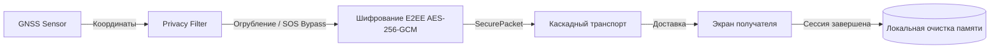

# Политика приватности геоданных (Privacy Architecture)

**Статус документа:** `COMPLETED`  
**Категория:** Безопасность и Приватность (`04-security`)

---

## 1. Принципы минимизации и защиты данных

1. **Минимизация данных (Data Minimization):** В сеть передаются только необходимые параметры: широта, долгота, высота, точность, заряд батареи и метка времени. Никаких персональных метаданных, номеров телефонов или IP-адресов в полезной нагрузке.
2. **Ограничение видимости (Purpose Limitation):** Только участники с подтвержденным членством в группе (`groupId`) и знанием группового ключа могут расшифровать местоположение.
3. **Отсутствие фоновой слежки:** Передача геоданных активна только в режиме экспедиции (`Expedition Mode = ACTIVE`).

---

## 2. Режимы приватности (Privacy Modes)

Пользователь может явно выбрать желаемый уровень детализации в настройках профиля:

```
┌─────────────────┬────────────────────────────────────────────────────────┐
│ Режим           │ Описание поведения и передаваемая точность             │
├─────────────────┼────────────────────────────────────────────────────────┤
│ NORMAL          │ Передача координат с максимальной точностью GNSS (~5м)  │
│ REDUCED         │ Искусственное огрубление сетки до квадрата 200x200м    │
│ EMERGENCY       │ Автоматическое включение макс. точности при сигнале SOS│
│ STEALTH         │ Локальная запись трека без вещания в радиоэфир         │
└─────────────────┴────────────────────────────────────────────────────────┘
```

> [!IMPORTANT]
> **Приоритет безопасности жизни (Safety-First Override):**
> Если пакет содержит флаг `isEmergency: true` или статус `mode === 'EMERGENCY'`, `PrivacyFilter` полностью игнорирует ограничения режимов `STEALTH` и `REDUCED`. В эфир передаются точные непреобразованные координаты GNSS, высота над уровнем моря, азимут и скорость перемещения. Вещание разрешается на всех доступных сетевых интерфейсах (`isBroadcastAllowed('EMERGENCY') === true`).

```typescript
// Реализация в src/core/security/privacy-filter.ts
if (mode === 'EMERGENCY' || location.isEmergency) {
  return {
    ...location,
    privacyMode: 'EMERGENCY',
    isEmergency: true,
  };
}
```

---

## 3. Жизненный цикл геоданных (Data Lifecycle)



- **Генерация:** Считывание аппаратных координат с фильтрацией дребезга (`Deadband`).
- **Фильтрация:** Применение выбранного режима приватности с гарантированным байпасом при сигнале SOS.
- **Шифрование:** Преобразование в непрозрачный зашифрованный пакет `SecurePacket` с цифровой подписью Ed25519.
- **Очистка:** При выходе из группы или завершении похода сессионные ключи и временный кэш стираются из памяти.

